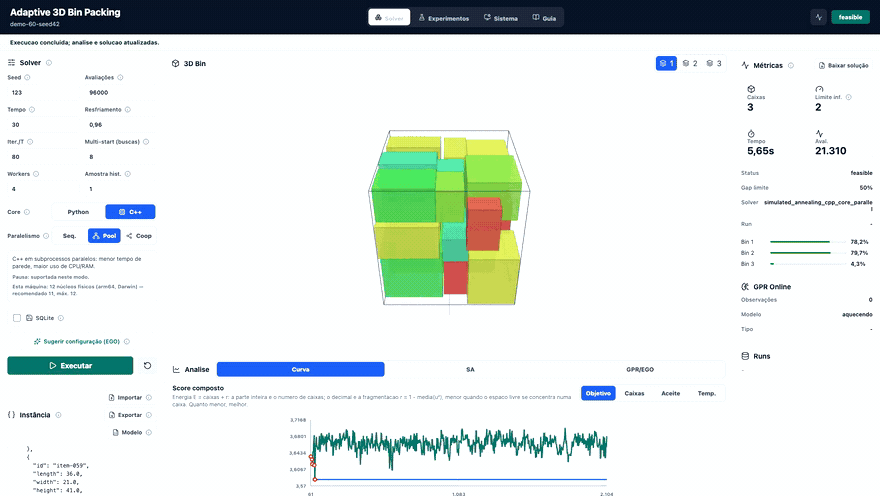
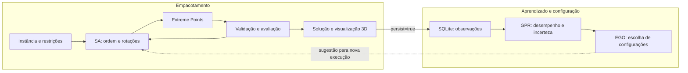

# Adaptive 3D Bin Packing

**Empacotamento 3D, aprendizado de desempenho e configuração adaptativa de metaheurísticas.**

Plataforma experimental para investigar **3D Bin Packing offline** e **configuração automática de algoritmos**. O problema de empacotamento consiste em posicionar itens retangulares em caixas idênticas, sem sobreposição, buscando reduzir o número de caixas.

O sistema integra um solver SA/Extreme Points, **GPR para modelar desempenho**, **EGO clássico e contextual para orientar configurações**, comparação com **SMAC3 e irace**, execução paralela e campanhas com avaliação estatística. A aplicação reúne Python, core C++ opcional, FastAPI, SQLite e uma interface React/Three.js.

[Demonstração](#demonstração) · [Executar](#executar-localmente) · [Como funciona](#como-funciona) · [GPR e EGO](#aprendizado-e-configuração-com-gpr-e-ego) · [Experimentos](#o-que-a-aba-experimentos-compara) · [Estado científico](docs/status.md) · [Guia de uso](docs/usage.md)

## Demonstração



[Assistir à demonstração em MP4](docs/assets/demo/packing-demo.mp4) · [Mídias e reprodução da captura](docs/media.md)

A captura mostra uma execução real da versão 0.3.0, com 8 buscas em 4 workers C++, e a inspeção da solução. É uma demonstração de funcionamento; uma instância isolada não mede desempenho em benchmarks.

## O que você pode explorar

- **Empacotamento 3D:** navegar pelas caixas, inspecionar os itens e acompanhar a curva de busca.
- **Busca:** Simulated Annealing sobre ordem e rotações, decodificado por Extreme Points com first fit e projeção dos pontos.
- **Restrições:** rotações ortogonais permitidas, distância mínima entre pares, peso total por caixa e proporção mínima de apoio da base.
- **Execução:** core Python ou C++, multi-start e processos paralelos. Parallel tempering e cooperação entre workers estão disponíveis no core Python.
- **Dados:** importar instâncias e exportar soluções em planilhas, salvar execuções em SQLite e reabrir resultados.
- **Aprendizado de desempenho:** execuções persistidas alimentam um GPR que relaciona características da instância, parâmetros e perda observada, com previsão e incerteza.
- **Configuração adaptativa:** EGO clássico e contextual, além de sugestões por instância a partir das observações disponíveis.
- **Experimentos:** comparação com configuração padrão, Random Search, SMAC3 HPO/AC, irace, políticas por classe/kNN e ablações, com treino/validação/teste e estatística pareada.

## Executar localmente

Requisitos: **Python 3.11+**, **Node.js 20.19+ ou 22.12+** e npm. Para comparar o decoder Python/C++ bit a bit, use Python **3.12+**. O core nativo requer um compilador com C++17 (`g++`).

```bash
git clone https://github.com/lucastcor/adaptive-3d-bin-packing.git
cd adaptive-3d-bin-packing
python3 -m venv .venv
source .venv/bin/activate
python -m pip install -e ".[dev]"
cd frontend
npm ci
cd ..
./scripts/run_all.sh
```

Abra [a interface](http://127.0.0.1:5173) e clique em **Executar**. A [documentação interativa da API](http://127.0.0.1:8000/docs) fica na porta 8000. `Ctrl+C` encerra os serviços. Para executar somente com Python: `./scripts/run_all.sh --no-native`.

Pela CLI, sem iniciar a interface:

```bash
adaptive-3dbp validate-instance data/raw/example_20.json
adaptive-3dbp solve --instance data/raw/example_20.json --seed 123
# Acrescente --native para selecionar o core C++.
```

O [guia de uso](docs/usage.md) cobre API, planilhas, paralelismo, campanhas e dependências opcionais.

## Como funciona



O SA explora ordem e rotações; o decoder constrói os placements e a validação verifica as restrições. As execuções também podem gerar dados para modelar e configurar o desempenho do solver.

## Aprendizado e configuração com GPR e EGO

Quando uma execução é persistida, o sistema salva instância, parâmetros, seed, resultado e métricas em SQLite, cria uma observação de aprendizado e reajusta o modelo quando há dados suficientes. As observações usadas pertencem à mesma versão compatível do solver.

O **GPR** estima a perda de uma configuração para uma instância e a incerteza dessa estimativa. A implementação usa um processo gaussiano com kernel **Matérn 5/2 ARD**, ruído por observação e ajuste de hiperparâmetros. O alvo padrão é o gap ao limite inferior acrescido de penalidade de falha; o tempo é reportado separadamente.

O **EGO** usa essas previsões e o **Expected Improvement** para orientar quais configurações avaliar durante o tuning. O EGO clássico busca uma configuração global; o contextual também considera as características da instância. Nas campanhas, a política contextual é congelada após o treino e recomenda configurações para novas instâncias pela média posterior prevista.

Na aplicação, o botão **Sugerir configuração (EGO)** e a API de sugestões consultam as observações disponíveis; durante o aquecimento, a sugestão é aleatória e sinalizada como tal. O aprendizado acontece entre execuções persistidas. O posicionamento dos itens continua a cargo do decoder e da busca.

Detalhes: [GPR](docs/gpr.md), [EGO](docs/ego.md) e [aprendizado por execução](docs/aprendizado_online.md).

## O que a aba Experimentos compara

### Modos de execução

O estudo de paralelismo compara **sequencial**, **pool independente** e **pool cooperativo** na instância selecionada, com múltiplas seeds e orçamento definido. A interface apresenta caixas, gap, tempo, avaliações por segundo e speedup em relação ao sequencial.

O pool independente pode usar processos Python ou subprocessos C++. A cooperação usa memória central no core Python. Há também paralelismo de campanhas, que executa runs independentes de diferentes configurações/instâncias/seeds; esse é outro nível de execução, distinto do multi-start de um solve.

**Parallel tempering** é um solver adicional disponível pela API/configuração, no core Python. Suas réplicas são intercaladas em um processo nesta implementação; ele não aparece como seletor específico nessa aba.

### Campanhas de configuração

A campanha compara estratégias de escolha dos parâmetros do **mesmo SA com Extreme Points**:

| Método | Papel no experimento |
|---|---|
| Configuração fixa padrão | Referência sem tuning |
| Random Search | Amostragem de configurações no espaço de busca |
| EGO clássico | Configuração global com GP e Expected Improvement |
| EGO contextual | Configuração por instância, considerando contexto e ruído entre seeds |
| SMAC3 HPO | Otimização de hiperparâmetros com perda média sobre instâncias |
| SMAC3 AC | Configuração de algoritmos com instâncias/features e racing |
| irace | Configuração por iterated racing |
| Por classe / kNN | Políticas simples de configuração por instância |
| Ablações | Efeito do incumbente plug-in e do ajuste de hiperparâmetros do GP |

SMAC3 e irace são configuradores de referência: eles escolhem parâmetros do solver de empacotamento. SMAC3 requer o extra Python `tuners`; irace requer R e o pacote correspondente. A campanha informa braços indisponíveis ou com erro.

As campanhas usam datasets sintéticos ou o benchmark **MPV**, separação de treino/validação/teste, seeds distintas e orçamento controlado em avaliações e runs do solver. O relatório inclui **Wilcoxon pareado, correção de Holm, intervalos bootstrap e tamanho de efeito**. As seeds são agregadas antes do teste; no MPV, as classes dependentes são agrupadas por `(n, v)`.

Campanhas já foram executadas com esses configuradores em versões anteriores. A repetição com o decoder da **0.3.0** faz parte da validação pendente. Veja o [protocolo experimental](docs/experiment_protocol.md) e o [estado científico](docs/status.md).

## Estado do projeto — 0.3.0

O 3D-BPP é um problema de otimização **NP-difícil**. Este projeto usa heurísticas e metaheurísticas; não oferece garantia geral de ótimo. Quando uma solução válida atinge um limite inferior válido, a contagem de caixas está certificada para aquela instância.

Na 0.3.0, o decoder passou a usar first fit entre caixas e projeção dos pontos extremos. Há testes de regressão contra três ordenações EP-FFD do benchmark MPV, com tolerância por classe. Isso valida parte do comportamento do decoder; **não demonstra superioridade sobre a literatura**.

**As campanhas históricas foram executadas com versões anteriores. Ainda falta uma campanha confirmatória com a 0.3.0.** Não há evidência atual para anunciar ganho do EGO contextual, speedup quantificado ou estado da arte. Veja a [análise técnica e científica](docs/status.md) e o [protocolo experimental](docs/experiment_protocol.md).

Limitações relevantes:

- Apoio de base e peso total não substituem simulação física: faltam centro de massa e carga suportada por item.
- O lower bound pode ser frouxo; gap até esse limite não é distância conhecida ao ótimo.
- O decoder Python/C++ tem testes de paridade; as trajetórias do SA usam geradores aleatórios distintos.
- O modo cooperativo é não determinístico. Parallel tempering e cooperação fazem fallback para Python.
- A API foi feita para execução local e não possui autenticação ou isolamento entre usuários.

## Verificação

```bash
source .venv/bin/activate
./scripts/build_native.sh
ADAPTIVE_3DBP_REQUIRE_NATIVE=1 python -m pytest
cd frontend
npm run build
```

Os testes de paridade usam fixtures versionadas em `tests/fixtures/`; não dependem de campanhas ou bancos pessoais. O [workflow de CI](.github/workflows/ci.yml) verifica backend, core nativo e build do frontend.

## Estrutura

```text
src/adaptive_3dbp/   domínio, decoder, busca, GPR, campanhas, API e CLI
cpp/                core C++17
frontend/           React, TypeScript e Three.js
configs/            espaços de busca e especificações de campanha
data/raw/           instâncias pequenas para começar
tests/              testes unitários, integração e fixtures
scripts/            execução, build, diagnósticos e preparação pública
docs/               documentação técnica e mídias selecionadas
```

Artigos baixados, rascunhos, resumos pessoais, bancos e saídas de campanhas não fazem parte da distribuição pública. As referências são mantidas como citações e links.

## Documentação e contribuições

| Documento | Conteúdo |
|---|---|
| [Uso](docs/usage.md) | CLI, API, planilhas e campanhas |
| [Estado científico](docs/status.md) | Evidências, limites e próximos experimentos |
| [Arquitetura](docs/architecture.md) | Camadas e fluxo de execução |
| [Simulated Annealing](docs/simulated_annealing.md) | Energia, temperatura e operadores |
| [GPR](docs/gpr.md) / [EGO](docs/ego.md) | Surrogate e configuração de algoritmos |
| [Aprendizado por execução](docs/aprendizado_online.md) | Persistência e atualização do GPR |
| [Paralelismo cooperativo](docs/paralelismo_cooperativo.md) | Coordenação e limites de determinismo |
| [Benchmark MPV](docs/benchmark_mpv.md) | Geração, orientação e separação dos dados |
| [Decisões científicas](docs/decisoes_cientificas.md) | Justificativas e correções |
| [Referências](docs/references.md) | Fontes primárias |

Para contribuir, leia [CONTRIBUTING.md](CONTRIBUTING.md). A definição da licença de distribuição está pendente; consulte [o estado da preparação pública](docs/public-release.md).

## Origem e agradecimentos

O projeto nasceu do interesse por otimização combinatória desenvolvido em um desafio de Bin Packing 1D, realizado por Lucas e Alysson durante a graduação. A exploração de SA e GRASP naquele desafio motivou estudos posteriores e esta implementação em 3D.

Alysson também contribuiu para a paralelização do algoritmo e do pipeline. Veja [os agradecimentos](ACKNOWLEDGMENTS.md).
